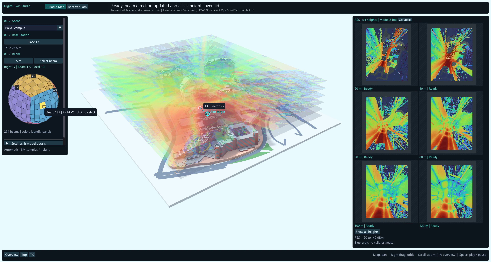

# Digital Twin Studio

[简体中文](README.md) | **English**

Interactive, beam-aware radio-map visualization in real-world 3D scenes, built on [Sionna RT](https://github.com/NVlabs/sionna-rt) and [sionna-rt-gui](https://github.com/NVlabs/sionna-rt-gui).



[Watch the Radio Map demo](media/radio-map-demo.mp4) · [Quick start](docs/QUICKSTART.md) · [Scene sources](docs/SCENE_SOURCES.md) · [Attribution and licenses](THIRD_PARTY_NOTICES.md)

This is a research demonstration, not a calibrated network-planning product. The research group's learned model outputs are **not integrated yet**. Current coverage comes from Sionna RT, using assumed electromagnetic materials.

## What it does

- Load PolyU campus, Mong Kok urban, or Kam Tin village scenes.
- Place a transmitter; aim at a target or select one of 294 discrete beams.
- Automatically calculate six horizontal RSS slices after selecting a beam.
- Inspect all six slices in a two-column panel, show their 3D stack, or isolate one height.
- Switch between responsive baked lighting (**Fast**) and refined visual ray tracing (**Original**). Camera interaction uses the responsive preview.
- A separate receiver-route workspace is available; the supplied demo video covers only Radio Map.

### Current coverage defaults

| Setting | Value |
|---|---|
| XY cell size | 3 m × 3 m |
| Monte Carlo budget | 8,000,000 launched samples per height, per selected TX |
| Height layers | Six uniform model-Z levels, derived from scene geometry |
| Propagation | Line of sight and specular reflection; maximum depth 5 |
| Display | All six layers overlaid after completion |
| Rendering | Fast initially; Original accumulates up to 512 visual samples/pixel |

The 8M budget is **not per cell**. Batches of linear path-gain estimates are combined with sample-count weights before conversion to RSS in dBm. It is separate from visual rendering samples. Budget completion is not a convergence or accuracy guarantee.

The stacked slices are samples of a 3D field, not a continuously solved volume. Heights are scene coordinates, not universally height above local ground. An open-sky mask excludes cells below the topmost surface, including underpasses. Dark blue can include cells with no positive power estimate; it does not prove that the physical signal is zero.

## Run on Windows

The validated development environment is Windows with Python 3.12 (64-bit), an NVIDIA CUDA-capable GPU, and a working NVIDIA driver. Other platforms and CPU-only use have not been validated for this customized application.

1. Install **Python 3.12 (64-bit)**, including the Python Launcher, and an NVIDIA GPU driver.
2. Select **Code → Download ZIP** on the repository page and extract the entire archive.
3. Double-click **`start.bat`** in the extracted folder. The first run creates the environment, installs dependencies over the Internet, and starts the application. Subsequent runs launch directly.

Alternatively, download with Git:

```powershell
git clone https://github.com/stevenyyzhang/Digital-Twin-Software.git
cd Digital-Twin-Software
.\start.bat
```

The repository does not bundle Python, CUDA drivers, or a virtual environment. First launch builds local lighting caches and can be slower. See [QUICKSTART.md](docs/QUICKSTART.md) for usage and troubleshooting.

## Repository layout

```text
sionna-rt-gui/            Application source and focused tests
polyu-stylized/           Required campus scene assets
mong-kok/                Required city scene assets
kam-tin/                 Required village scene assets
docs/                   Usage, scene sources and demo recording notes
media/                  Radio Map video and preview
tools/                  Repository checks and demo capture
polyu-stylized-config.yaml
setup.ps1
start.ps1
start.bat
```

Only referenced runtime assets and the OSM provenance extract are included. Intermediate Blender projects, downloaded source archives, old variants, caches, screenshots from development, and Python runtimes are excluded. Geometry-generation reproducibility from the original downloads is not included; ready-to-load scene assets are supplied.

## Attribution and licensing

Upstream application code is Apache-2.0; its license and copyright headers are preserved. See [LICENSE](LICENSE) and [THIRD_PARTY_NOTICES.md](THIRD_PARTY_NOTICES.md). Scene data has separate terms and is **not covered by the software license**. Each scene includes an `ASSET_LICENSE.md` notice. Official sources permit conditional redistribution. Preserve source, ownership and modification notices and comply with the applicable data terms when using these assets.

Geometry and some terrain imagery derive from the Hong Kong SAR Government, Lands Department, [3D Visualisation Map](https://3d.map.gov.hk/), subject to the [official Terms and Conditions of Use](https://portal.csdi.gov.hk/csdi-webpage/doc/TNC). Campus auxiliary ground/road data includes © [OpenStreetMap contributors](https://www.openstreetmap.org/copyright), ODbL. The original OSM extract and complete derived support meshes are supplied with their [separate notice](polyu-stylized/ASSET_LICENSE.md). Processing includes coordinate conversion, cropping, mesh simplification, material grouping, texture conversion, recoloring, window styling and display normal processing. Each scene notice describes its applicable changes.

These assets are project-processed display versions, not unmodified official data or surveyed facade materials. Original ownership is retained. No government or university endorsement is claimed. Source links, terms and modification scope are provided in [THIRD_PARTY_NOTICES.md](THIRD_PARTY_NOTICES.md) and each scene's `ASSET_LICENSE.md`.
